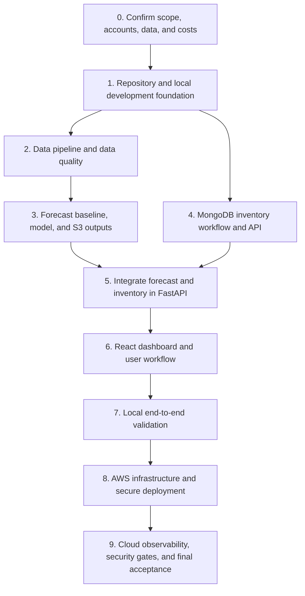

# RetailPulse AI — Implementation Plan

## Purpose

This plan sequences the project features so each stage has working prerequisites, testable outputs, and a clear completion gate before the next stage begins. It is aligned with [RetailPulse_AI_Project_Details.md](./RetailPulse_AI_Project_Details.md). For AWS account, CLI, IAM, Bedrock, S3, EC2, and CloudWatch setup, see [AWS_setup.md](./AWS_setup.md).

The order is based on dependencies rather than fixed calendar weeks. Complete and verify one stage before moving its dependent work into the main branch. Build the first working version locally, then deploy it to AWS.

> **Reliability note:** no plan can guarantee an error-free system. This plan reduces avoidable errors with small increments, explicit data/API contracts, automated tests, fail-fast checks, health checks, and a rollback path.

## Target delivery sequence



Stages 2 and 4 can be developed in parallel after Stage 1 if enough time is available. The final integration in Stage 5 depends on both. Do not start cloud deployment until the local end-to-end workflow passes.

## Stage 0 — Confirm scope and prerequisites

**Purpose:** avoid building around unavailable data, services, or assumptions.

### Tasks

- Confirm access to the tutorial dataset and list the available columns for sales, products, stores, and promotions.
- Confirm the source and format of demo inventory inputs: on-hand units, inbound units, supplier lead time, and safety-stock threshold.
- Decide the AWS region and check availability/access requirements for Amazon Bedrock models.
- Confirm that the Databricks workspace and its AWS/S3 configuration are available and within the project budget.
- Confirm MongoDB Atlas access, or select MongoDB Community Server for local development and Atlas for the demo.
- Set a cost limit and identify resources that must be stopped or removed when not in use.
- Define the initial forecast horizon (30 days in the brief), supported user workflow, and what is explicitly out of scope.

### Completion gate

- Dataset fields and inventory-input provenance are documented.
- AWS region, Bedrock availability, Databricks/S3 path, and MongoDB development option are confirmed.
- No real or sensitive retail data is required for the initial demo.

### If blocked

Use synthetic or course-provided sample data for the inventory workflow. Do not derive on-hand stock or supplier lead time from sales. If Bedrock access is unavailable, keep the application functional without chat and defer the LLM integration.

## Stage 1 — Repository and local development foundation

**Purpose:** establish reproducible local development before feature work begins.

### Expected project layout

You already have the `data` and `Databricks` folders. Keep them as reference inputs; **do not copy the tutorial's Backend folder or reuse its Backend `pyproject.toml`, `uv.lock`, source code, or `.env`**. Build a separate Backend project yourself and consult the video/source only to understand features as you reach them.

```text
RetailPulse_AI/
├── backend/                         # Your independently created UV project
│   ├── pyproject.toml
│   ├── uv.lock
│   ├── .venv/                       # Local only; never commit
│   ├── src/
│   │   ├── __init__.py
│   │   ├── main.py
│   │   ├── data/
│   │   ├── genai/
│   │   └── models/
│   └── tests/
│       └── test_health.py
├── data/                            # Copied tutorial data; leave in place
├── Databricks/                      # Copied tutorial assets; leave in place
└── RetailPulse_AI_Implementation_Plan.md
```

Use the lowercase `backend` folder consistently in commands (Windows treats casing flexibly, but Git and deployment environments may not). Keep UV project files inside Backend. Do not initialize a second UV project at the repository root. In this layout, `src` is intentionally the Python import package, so the app is imported as `src.main`; you do not need another nested `retailpulse_api` folder.

### Backend setup walkthrough — build it from scratch

This walkthrough creates only the Backend foundation. It does not create the React app or implement the tutorial's business features yet. Follow the steps in order, run commands from the stated directory, and understand the output before continuing.

#### 1. Open the repository root in VS Code

1. Open the folder containing `data` and `Databricks` in VS Code.
2. Open **Terminal → New Terminal** and confirm you are at the repository root:

   ```powershell
   Get-Location
   Get-ChildItem -Force
   ```

3. Confirm `data` and `Databricks` are visible. If not, use **File → Open Folder** to open the correct root. Do not run setup commands from inside either data folder.

#### 2. Verify UV and Python

```powershell
uv --version
python --version
```

Use Python 3.12 for this initial setup unless the tutorial's dependency constraints or your installed Python require another compatible version. If `uv` is not recognized, install UV using an approved Windows package manager or its official installation instructions, restart VS Code, and verify again. Do not proceed until the commands work.

#### 3. Create a new standalone Backend project

Run this once from the repository root:

```powershell
uv init --app --name retailpulse-api --python 3.12 .\backend
```

This scaffolds a new application project in `backend`, including its own `pyproject.toml`, without requiring an installable Python package named `retailpulse_api`. It does not copy or depend on the tutorial's Backend. If `backend` already exists, inspect it first; do not overwrite or initialize over files you want to keep. To start clean, create a new empty directory or choose a different name, then update later paths consistently.

Enter the newly created project and inspect the scaffold:

```powershell
Set-Location .\backend
Get-Location
Get-ChildItem -Force
Get-Content .\pyproject.toml
```

Confirm the project name and Python requirement. The distribution/project name `retailpulse-api` in `pyproject.toml` is metadata; it does not require a same-named source folder. The source layout in this guide uses `src` as the import package.

**If you already ran the earlier command with `--package`:** do not rerun `uv init` and do not delete the Backend. Keep your installed dependencies and `uv.lock`, but edit `pyproject.toml` to remove the generated `[project.scripts]` section and `[build-system]` section, then add:

```toml
[tool.uv]
package = false
```

Keep the `[project]` metadata and dependencies. This tells UV to manage the environment without trying to install/build an import package named after the distribution. Save the file, then run `uv sync` from `backend`. Your app will be served directly from the `src` package.

#### 4. Add only the initial Backend dependencies

From inside `backend`, add the web framework and local development/test tools:

```powershell
uv add "fastapi[standard]"
uv add --dev pytest httpx ruff
uv sync
```

What these do:

- `fastapi[standard]` defines the HTTP API and installs FastAPI's standard extras, including its `fastapi` CLI and Uvicorn support.
- `pytest` runs tests, and `httpx` supports FastAPI's test client.
- `ruff` provides Python lint/format tooling.
- `uv add` records dependencies in `pyproject.toml` and updates `uv.lock`.
- `uv sync` installs the locked project environment, normally in `backend/.venv`.

Keep `pyproject.toml` and `uv.lock` in Git. Do not commit `.venv`. Use `uv run <command>` from Backend so you do not need to manually activate the environment. Avoid adding MongoDB, AWS, Bedrock, or Databricks libraries until a later feature needs them.

In VS Code, press **Ctrl+Shift+P**, run **Python: Select Interpreter**, and select the interpreter under `backend\.venv\Scripts\python.exe`. If it is not listed, choose **Enter interpreter path** and browse to that file. This makes editor diagnostics and autocomplete use the same environment as `uv run`. You can verify the command-line environment with:

```powershell
uv run python --version
```

#### 5. Create the source folders and first FastAPI endpoint

Using the VS Code Explorer, create `src\__init__.py` if it does not exist, and create `src\main.py`. Keep your `data`, `genai`, and `models` directories under `src`. Add an `__init__.py` to each subfolder when you begin importing Python modules from it.

```text
backend/
├── src/
│   ├── __init__.py
│   ├── main.py
│   ├── data/
│   ├── genai/
│   └── models/
└── tests/
    └── test_health.py
```

Put this in `src/main.py`:

```python
from fastapi import FastAPI

app = FastAPI(title="RetailPulse AI API")


@app.get("/health")
def health() -> dict[str, str]:
    return {"status": "ok"}
```

This endpoint is deliberately small: it confirms that Python can import `src` and Uvicorn can serve the FastAPI object named `app`. Keep business logic out of this file as the application grows.

#### 6. Run and inspect the API

From `backend`, start the development server with FastAPI CLI:

```powershell
uv run fastapi dev src/main.py
```

Leave the terminal running. Open:

- `http://127.0.0.1:8000/health` — should return `{"status":"ok"}`.
- `http://127.0.0.1:8000/docs` — should show FastAPI's interactive API documentation and the health route.

Stop the server with **Ctrl+C**. If the CLI reports that `fastapi[standard]` is missing, run `uv add "fastapi[standard]"` and `uv sync` from `backend`. If the app cannot be imported, check that the current directory is `backend`, `src\__init__.py` and `src\main.py` exist, `pyproject.toml` contains `[tool.uv] package = false`, and `src/main.py` defines `app = FastAPI(...)`.

Alternatively, run Uvicorn directly:

```powershell
uv run uvicorn src.main:app --reload
```

#### 7. Add and run a test

Put this in `tests/test_health.py`:

```python
from fastapi.testclient import TestClient

from src.main import app


def test_health_returns_ok() -> None:
    client = TestClient(app)
    response = client.get("/health")

    assert response.status_code == 200
    assert response.json() == {"status": "ok"}
```

Run checks from `backend`:

```powershell
uv run pytest
uv run ruff check .
uv run ruff format --check .
```

Fix failures rather than ignoring them. If `ruff format --check .` reports formatting differences, run `uv run ruff format .`, inspect the changed files, then rerun the checks.

#### 8. Protect local configuration and verify Git state

No secrets are needed for the health endpoint. Do not create a `.env` file yet. When a later feature requires local configuration, add a `.env.example` with placeholder names and make sure `.env` is ignored before entering secrets.

From the repository root, confirm that local environment files and the virtual environment are ignored:

```powershell
Set-Location ..
git check-ignore backend/.venv backend/.env
git status --short
```

`git check-ignore` should list paths covered by ignore rules. If a path is not ignored, update the repository `.gitignore` before adding any local secret or environment. Review `git status` and commit only source/configuration/lock files—not `.venv`, `.env`, or data exports containing sensitive information.

#### 9. Use the tutorial as a learning reference, not as the Backend setup

After the health endpoint and test pass:

1. Study the tutorial's next Backend feature and identify its responsibility, inputs, outputs, and external dependencies.
2. Implement that responsibility in your own `backend/src/` modules, grouping related code in `data`, `genai`, and `models` as appropriate and following the architecture and milestones in this plan.
3. Add a test for the new behavior before integrating the next feature.
4. Compare behavior with the tutorial to learn; do not paste the whole Backend or its environment files into your project.
5. Keep Databricks pipeline code in `Databricks/`; expose a stable data contract to the API rather than importing notebook code into FastAPI.

#### Common setup errors

| Error/symptom | Check/fix |
|---|---|
| `uv` is not recognized | Restart VS Code after installing UV; verify `uv --version`. |
| UV says it cannot find a project | Check `Get-Location`; `pyproject.toml` must be in the current `backend` directory for these commands. |
| Backend already exists | Inspect it before initializing. Do not overwrite it; choose a different empty directory if you intend a fresh scaffold. |
| `uv add` says `Expected a Python module at: src\retailpulse_api\__init__.py` | The generated project is still configured to build/install a package named after the distribution. In `pyproject.toml`, remove the generated `[project.scripts]` section (it points to that package) and add `[tool.uv]` with `package = false`. Then run `uv sync` and retry `uv add "fastapi[standard]"`. Do not use `--frozen` to bypass the package error. |
| `Could not import module src.main` | Check `src\__init__.py`, `src\main.py`, `[tool.uv] package = false`, and that commands run from `backend`. |
| Address/port is already in use | Stop the other server or pass `--port 8001` to Uvicorn. |
| `git check-ignore` prints no path | Add the applicable `.venv`/`.env` ignore rules to the repository `.gitignore`; never commit secrets. |

### Remaining Stage 1 tasks

- Document the Backend setup and run commands.
- Define shared identifiers and API/data schemas for `store_id`, `product_id`, dates, quantities, forecast values, and timestamps.
- Add Dockerfiles for the React/Nginx frontend and FastAPI backend after the Backend works locally.
- Add Docker Compose for local frontend/backend and MongoDB services when those components exist.
- Add a basic Jenkins CI job to run tests, Ruff, dependency checks, and later security scans.
- Build the React frontend after the Backend API contract is stable.

### Completion gate

- The Backend was independently scaffolded with UV, uses the selected `src` layout, and does not rely on the tutorial's Backend files.
- `uv sync`, API startup, health endpoint, `pytest`, and Ruff checks all work from the Backend directory.
- `pyproject.toml` and `uv.lock` describe the new Backend; `.venv` and `.env` are not committed.
- `data` and `Databricks` remain separate from the Backend application.
- A new developer can repeat the setup using this guide.

## Stage 2 — Data ingestion, validation, and curated datasets

**Purpose:** create trustworthy model inputs before implementing forecasting.

### Tasks

- Implement Databricks ingestion of the available source files into the **Bronze** layer with ingestion timestamps and source metadata.
- Build the **Silver** layer with explicit type conversion, required-field checks, duplicate handling, and documented invalid-record behavior.
- Build the **Gold** layer with product/store/date sales aggregates and only features supported by the actual dataset.
- Add data-quality checks for missing identifiers, invalid dates, impossible quantities, duplicate keys, and unexpected schema changes.
- Store the data lake outputs in the configured private S3 bucket using environment-specific paths.
- Log job status, duration, rejected-record counts, and input/output freshness.

### Completion gate

- A representative dataset completes the pipeline from Bronze to Gold.
- Row counts and key uniqueness are checked at each transformation boundary.
- Invalid records are reported or quarantined; they are not silently treated as valid.
- A rerun has documented behavior and does not create unintended duplicate outputs.

## Stage 3 — Forecast baseline, model, and forecast outputs

**Purpose:** produce an evaluated, versioned forecast that the application can consume.

### Tasks

- Create a simple baseline (for example, recent-period average or seasonal naive) before training a more complex model.
- Split data chronologically into train, validation, and test windows; do not randomly split time-series observations.
- Train the initial LightGBM model and track parameters, code/run metadata, and evaluation metrics with MLflow.
- Compare the model against the baseline. Record the evaluation dates, metric definitions, results, and limitations.
- Generate forecasts for the agreed horizon and write a versioned output to S3 with product/store keys, forecast dates, model version, and generation timestamp.
- Validate the forecast output schema and check for missing/duplicate keys before publishing it for application use.
- Make the current forecast location and version discoverable to the backend without hard-coding environment-specific paths.

### Completion gate

- Model evaluation is reproducible and includes a baseline comparison.
- Forecast outputs pass schema, key, date-range, and nonnegative-value checks where applicable.
- A sample forecast can be read from S3 using the intended least-privilege access.
- The project reports measured results rather than claiming an unverified accuracy target.

## Stage 4 — MongoDB inventory workflow

**Purpose:** implement the project’s distinct NoSQL assignment feature.

### Tasks

- Define MongoDB document schemas for `inventory_snapshots`, `inventory_alerts`, and `replenishment_actions`.
- Add validation for required identifiers, nonnegative quantities, valid timestamps, and acceptable lead-time values.
- Add indexes for common store/product/time lookups, alert status, and action history.
- Implement API operations to create/read inventory snapshots and list alerts/actions.
- Implement the initial transparent risk calculation using the selected forecast and documented inventory inputs.
- Persist the inputs and calculated values associated with each alert so users can understand why it was raised.
- Record reviewed actions with status, note, timestamp, and user identifier where authentication is available.
- Make alert generation idempotent for a given store/product/forecast window to avoid duplicate alerts on retries.

### Completion gate

- Valid snapshot, alert, and action documents survive service restarts.
- Invalid or missing required inputs return clear validation errors and do not create success-shaped records.
- Repeating an alert-generation request does not create unintended duplicates.
- A stale or incomplete inventory input is clearly identified and does not produce an unqualified recommendation.

## Stage 5 — FastAPI integration

**Purpose:** make the model outputs and MongoDB workflow available through a consistent, validated API.

### Tasks

- Add forecast retrieval from S3 and MongoDB inventory/alert/action endpoints.
- Implement the inventory-risk calculation in backend code, not in the frontend or the LLM.
- Define request/response models and consistent error responses for missing forecasts, stale inventory, database outages, and invalid input.
- Add pagination and filters to list endpoints where appropriate.
- Keep MongoDB, S3, and Bedrock credentials server-side; never expose them to the browser.
- Add unit tests for business rules and integration tests for representative database and forecast retrieval paths.
- Add request IDs and structured logs while avoiding tokens, secrets, and unnecessary document contents.

### Completion gate

- API contract tests cover successful and failure responses.
- Missing/unavailable forecast data returns an explicit service/data error, not fabricated values.
- MongoDB and S3 failures are logged and surfaced clearly without returning a false success.
- The API health check distinguishes service liveness from required dependency readiness as appropriate.

## Stage 6 — React dashboard and user workflow

**Purpose:** deliver the primary user experience on top of a stable API contract.

### Tasks

- Add store/product selectors and historical-versus-forecast charts.
- Display forecast horizon, model version, and forecast generation date.
- Add inventory views for snapshot freshness, risk alerts, calculation inputs, and recommendation rationale.
- Add forms to submit inventory snapshots and record a reviewed action.
- Display API validation, unavailable-data, and dependency errors in clear user-facing states.
- Ensure that the dashboard never implies that an AI-generated explanation is an observed fact or an automatic purchase decision.
- Add frontend tests for the critical selection, loading, error, and action flows.

### Completion gate

- A user can select a product/store and see the corresponding forecast and inventory context.
- Submitting an invalid form gives a useful error and does not show success.
- A recorded action can be retrieved after refresh/restart.
- Loading, empty, stale-data, and service-error states are distinguishable.

## Stage 7 — Optional grounded analytics with Amazon Bedrock

**Purpose:** add GenAI after trusted forecast and inventory retrieval are already working.

### Tasks

- Confirm the selected model, region access, cost, request limits, and IAM permissions.
- Implement a backend-only Bedrock client using the EC2 instance role in AWS; use a local development credential profile only for local development.
- Retrieve relevant, authorized values from the API data sources and pass bounded context to the model.
- Instruct the model to identify missing information and avoid inventing figures.
- Label generated text as AI-generated and keep numeric forecasts/risk calculations authoritative in application code.
- Add timeouts, request-size limits, usage/error logging, and a clear unavailable-model fallback.

### Completion gate

- The application remains usable when Bedrock is disabled or unavailable.
- A model failure is reported as an explanation-service error; the system does not return a fabricated answer.
- Numeric facts displayed in answers can be traced to retrieved application data.

## Stage 8 — AWS infrastructure and deployment

**Purpose:** deploy the verified local application with repeatable AWS infrastructure and a safe image flow.

### Tasks

- Use Terraform for the project’s AWS resources, including the EC2 instance, security group, IAM instance role/policies, S3 permissions, Parameter Store references, and CloudWatch configuration.
- Keep the S3 bucket private and encrypted; grant EC2 access only to the required forecast paths.
- Configure EC2 as an AWS Systems Manager managed node and verify SSM connectivity before using it for deployments.
- Install and configure Docker Engine on EC2; ensure container restart behavior and disk usage are understood.
- Configure the React/Nginx container to serve the frontend and proxy API requests to FastAPI. Expose only the required web ports; do not expose the FastAPI container directly unless necessary.
- Configure TLS for public traffic and restrict administrative access. Prefer Systems Manager Session Manager over broadly exposed SSH.
- Store runtime secrets in Parameter Store SecureString. Keep Docker Hub push credentials in Jenkins protected credentials; if Docker Hub repositories are private, give EC2 a read-only pull token through a protected runtime mechanism.
- Configure Jenkins to run tests and security checks, build versioned images, scan with Trivy, and push to Docker Hub only after scans pass.
- Configure Jenkins deployment to invoke SSM Run Command, deploy explicit image tags, and run a post-deployment health/smoke test.
- Keep the previous known-good image tags so a failed deployment can be rolled back.
- Test Terraform plan and apply in a controlled environment; never put secret values in Terraform source, plans, or state.

### Completion gate

- Terraform creates the required resources with least-privilege access and documented cost.
- EC2 is reachable through SSM and can access only its required S3/Parameter Store/Bedrock/CloudWatch resources.
- Jenkins publishes a versioned image only after passing tests and the Trivy severity policy.
- Deployment health checks pass, and a rollback to the prior image tags is documented and tested.
- The public application is reachable only through the intended frontend entry point.

## Stage 9 — Observability, security hardening, and final acceptance

**Purpose:** verify operation and demonstrate course outcomes, not just a successful deployment.

### Tasks

- Configure the CloudWatch Agent or log forwarding for system, container, and application logs; add CloudWatch alarms for actionable failures.
- Expose a small, bounded set of Prometheus application metrics and build Grafana dashboards for API health, inventory activity, and pipeline/model status.
- Add Jenkins checks for Gitleaks, Python and frontend dependency audits, Bandit, Checkov, tests, and Trivy image scans.
- Document any accepted security-scan exception and its rationale; do not silently suppress findings.
- Confirm that secrets are not present in Git history, container layers, logs, or frontend assets.
- Run a full acceptance scenario: ingest data → generate forecast → retrieve forecast → submit inventory snapshot → create risk alert → review action → view dashboard → request optional explanation.
- Record evidence for the course demonstration: architecture, test results, scan results, model evaluation, and monitoring dashboard.
- Review AWS, Databricks, MongoDB Atlas, Docker Hub, and model usage costs; stop or remove resources that are not needed.

### Completion gate

- The end-to-end scenario succeeds from a clean deployment and each failure path produces a clear error.
- Monitoring shows service and pipeline health and an actionable test alert has been verified.
- Security checks run in CI and block the configured release conditions.
- Setup, deployment, rollback, and teardown steps are documented.

## Release workflow — run in this order for every change

1. Make a small change on a feature branch and keep secrets/data out of the commit.
2. Open a pull request and run formatting, lint, unit, API/frontend, secret, dependency, and Terraform checks.
3. If code or dependency tests fail, stop; fix and rerun. Do not publish or deploy.
4. Build images from the reviewed commit using immutable version tags (commit SHA or release version).
5. Run Trivy against each built image. If the configured policy fails, stop before pushing.
6. Push approved images to Docker Hub using Jenkins' protected credentials.
7. Deploy the exact image tags to EC2 using SSM Run Command.
8. Run health and smoke tests. If they fail, collect logs, roll back to the last known-good image tags, and mark the deployment failed.
9. Verify CloudWatch logs/alarms and Prometheus/Grafana dashboards after deployment.
10. Record the deployed commit, image tags, model/forecast version, test results, and any approved exceptions.

## Error prevention and recovery rules

- **One source of truth per interface:** keep API schemas and MongoDB/data contracts explicit and versioned.
- **Fail fast:** reject invalid data and configuration at ingestion/startup rather than silently defaulting to plausible values.
- **No fabricated success:** failed writes, unavailable dependencies, and failed deployments must return/report failure.
- **Safe retries:** make ingestion and alert generation idempotent where possible; use request IDs or unique keys for retried operations.
- **Visible data freshness:** expose the observation and forecast timestamps and stop/qualify recommendations when required inputs are stale.
- **Separate credentials by purpose:** Jenkins push/deploy credentials, EC2 runtime IAM role, MongoDB credentials, and Bedrock access must not be shared unnecessarily.
- **Deploy immutable versions:** do not use `latest` as the only deployment reference; retain a known-good image tag for rollback.
- **Keep a local path:** retain Docker Compose or equivalent local instructions so the project can still be demonstrated if cloud services or credits are unavailable.
- **Control spending:** check current service prices and student-credit terms before provisioning; stop EC2 when unused and remove billable resources after the demo.

## Definition of done

The project is ready for its final demonstration when a reviewer can:

1. Follow the documented local setup.
2. Inspect a time-based model evaluation and trace a forecast to its model version.
3. See a forecast and its data freshness in the dashboard.
4. Submit inventory data, inspect a transparent risk alert, and record/retrieve a reviewed action in MongoDB.
5. Understand how Jenkins, Trivy, Docker Hub, Terraform, EC2, IAM, SSM, Parameter Store, Bedrock, and CloudWatch fit together.
6. Observe clear test failures, application errors, and deployment rollback behavior without exposing credentials.
