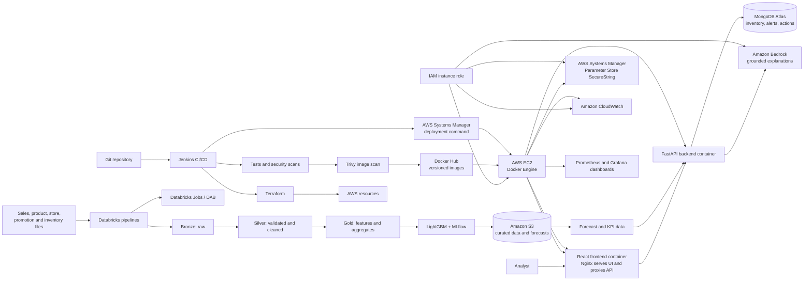

# RetailPulse AI — Project Brief and Architecture

## 1. Project overview

**RetailPulse AI** is a retail demand-forecasting and inventory decision-support application. It combines the sales forecasting and GenAI analytics workflow from the video tutorial with a new MongoDB-backed inventory workflow.

The project is intended to demonstrate:

- An end-to-end AI application suitable for **Forward Deployed Engineer (FDE)** and **AI/ML** portfolios: translating a business problem into data pipelines, models, APIs, a user interface, deployment, and operations.
- A substantive **MongoDB** feature for the semester NoSQL assignment, rather than adding a database that does not solve a project need.
- Applied **cloud, DevOps, and DevSecOps** practices for the open-minor course: infrastructure as code, automated delivery, security checks, monitoring, and cost awareness.

The video tutorial is the foundation for demand forecasting, the dashboard, and conversational analytics. RetailPulse adds operational inventory data and a human-reviewed replenishment workflow.

## 2. Problem statement

Retail teams need to decide what products to replenish, at which stores, and when. Sales history, promotions, product details, and store information are often spread across files or systems. Forecasting and inventory decisions made manually or from fixed averages can lag behind demand changes, contributing to stockouts, excess inventory, and avoidable carrying costs.

RetailPulse AI will bring those signals together. It will forecast near-term product/store demand, compare forecasts with reported inventory and lead times, highlight potential stockout or overstock risks, and let a user review and record a replenishment decision. A grounded analytics assistant will help users understand the dashboard and the factors behind a forecast.

**Scope note:** a demand forecast is an estimate, not a guarantee. Recommendations are decision support only; the application will not place purchase orders automatically.

## 3. Goals and success criteria

### Goals

1. Ingest retail sales, product, store, and promotion data and produce reproducible forecasts.
2. Show historical sales, forecast values, relevant KPIs, and risk alerts in an interactive dashboard.
3. Use MongoDB for a real operational workflow: inventory snapshots, inventory risk alerts, and reviewed replenishment actions.
4. Provide a natural-language interface that answers questions using authorized, retrieved project data rather than inventing figures.
5. Demonstrate cloud-native packaging, infrastructure automation, CI/CD, security checks, and observability.
6. Keep the first implementation small enough to build, explain, and demo as a semester project.

### Suggested measurable MVP criteria

- A user can select a store and product and view historical data, a forecast, and the forecast horizon.
- Given an inventory snapshot and lead-time inputs, the application displays a transparent stock-risk calculation and recommendation.
- A user can acknowledge an alert and record, update, and retrieve a replenishment action; the action remains available after a restart.
- The model is evaluated against a time-based holdout and its metrics are recorded. Report a baseline alongside the selected model.
- A pull request pipeline runs automated tests and security checks; a successful approved pipeline can deploy the application to a demo environment.
- Logs and metrics allow a developer to identify failed requests, pipeline errors, and forecast job failures.

Treat numerical model targets as hypotheses until a baseline has been measured on the chosen data. Do not promise a specific accuracy in advance.

## 4. Users and primary workflow

**Primary user:** a store or inventory analyst who reviews demand and inventory risk.

**Supporting user:** a developer or ML engineer who monitors data, model, and service health.

1. A scheduled or manual data pipeline ingests sales, product, store, and promotion files.
2. Databricks validates and transforms the data, builds features, trains/evaluates the forecasting model, and writes forecasts.
3. The user selects a store/product in the React dashboard and views historical performance and forecast.
4. The backend retrieves the relevant forecast and the latest inventory snapshot. The application calculates risk using inventory inputs such as on-hand quantity, inbound quantity, and supplier lead time.
5. The user reviews an alert, records a replenishment action or note, and can later inspect the action history.
6. The analytics assistant answers questions using relevant forecast, KPI, and inventory context returned by the backend. It must distinguish estimates from observed values.

## 5. Functional boundaries

### Included in the MVP

- Batch sales forecasting for product/store combinations, initially for a 30-day horizon.
- Dashboard selectors, KPI summaries, historical/forecast charts, and inventory-risk views.
- Inventory snapshot import or entry for the demo, including on-hand quantity, inbound quantity, and lead time.
- MongoDB persistence for inventory snapshots, alerts, and user-reviewed actions.
- Forecast explanation and analytics chat with server-side data retrieval.
- Containerized services and one cloud demo environment.
- Automated tests, security gates, deployment, and basic dashboards/alerts.

### Explicitly out of scope initially

- Automatic purchase orders, payments, or changes to a retailer's source-of-record system.
- Guaranteed forecast accuracy or autonomous decisions based on an LLM.
- Real-time streaming, multi-region high availability, or a full enterprise identity rollout.
- Treating MongoDB as the historical analytics warehouse or as the model-training data lake.

## 6. High-level architecture

The deployment uses Docker Hub as the image registry and one EC2 instance with Docker Engine as the container host. React and FastAPI remain separate containers. The frontend image serves the built React application with Nginx and proxies API requests to the FastAPI container, providing one web entry point. Jenkins builds and scans both images, pushes versioned tags, then triggers deployment on EC2 through AWS Systems Manager. The instance pulls the selected image tags and runs the containers. This is intentionally simpler than a managed container platform, but the single-instance design is not highly available.

## 7. Components and tools

| Component/tool | Role in RetailPulse AI | Why it is used |
|---|---|---|
| **Python** | Data pipelines, model code, and backend | Shared language for the ML and API portions. |
| **Databricks (Python/SQL)** | Bronze/silver/gold processing, feature engineering, training, batch forecasting, and job orchestration | Follows the tutorial and provides a clear, repeatable ML workflow. |
| **Delta tables / Amazon S3** | Store raw, cleaned, curated, and forecast datasets | Suits large analytical and historical data; keeps those workloads separate from operational MongoDB records. Configure Databricks on AWS to use S3 for the project's data lake. |
| **LightGBM** | Initial regression model for product/store demand | A practical tabular forecasting model. Compare it with a simple baseline and use time-aware validation. |
| **MLflow Model Registry** | Track runs, metrics, model versions, and the selected model | Makes model evaluation and promotion traceable. |
| **Databricks Jobs and DAB (Databricks Asset Bundles)** | Schedule jobs and version/deploy job definitions | Automates the ML workflow and avoids hand-configured job drift. |
| **React** | Dashboard, charts, selectors, inventory views, and action forms | Provides the interactive user experience from the tutorial. |
| **FastAPI** | Health, forecast, inventory, action, and analytics endpoints | Validates requests and centralizes access to forecast outputs in S3, MongoDB, and Bedrock. |
| **MongoDB Atlas** | Operational inventory snapshots, risk alerts, and reviewed replenishment actions | Adds a genuine document-database workflow with evolving records and action history. It is not the analytics warehouse. |
| **Amazon Bedrock** | Optional natural-language explanations and analytics chat | The backend sends bounded, retrieved project context to a supported foundation model; the model does not calculate the authoritative forecast or inventory quantity. Confirm model access, region availability, and cost before implementation. |
| **Docker** | Package frontend and backend into repeatable images | Supports consistent local testing and cloud deployment. |
| **Docker Hub** | Store versioned frontend and backend images | Keeps the registry workflow familiar and separate from the EC2 compute host. Use private repositories and scoped access tokens; the registry stores images but does not run containers. |
| **AWS EC2 and Docker Engine** | Run the frontend and backend containers on a virtual machine | A familiar, straightforward deployment for the MVP. EC2 provides compute; Docker Engine runs the containers. A reverse proxy/web server routes incoming requests. This single-instance design has a single point of failure and needs OS/Docker maintenance. |
| **Nginx (in the frontend image)** | Serve the built React application and route API requests to FastAPI on the EC2 instance | Keeps the frontend and backend in separate containers while presenting a single web entry point. Configure public ingress and TLS deliberately; do not expose the FastAPI container port directly unless required. |
| **AWS Systems Manager (SSM) Run Command** | Allow Jenkins to trigger deployment commands on EC2 | Avoids opening SSH to the public internet for routine deployment. The instance must be configured as a Systems Manager managed node, and Jenkins needs narrowly scoped deployment permissions. |
| **AWS Systems Manager Parameter Store (SecureString)** | Store runtime secrets and configuration, including a Docker Hub read token if private images are used | Use SecureString encryption and narrowly scoped IAM permissions. Parameter Store is the selected MVP option; do not place secret values in Terraform files, plans, or state. |
| **AWS IAM** | Authorize EC2, Jenkins deployment, and other AWS service access | Attach an instance role to EC2 for only required actions (for example, reading selected parameters and forecast objects in S3, writing logs, and invoking Bedrock). Give Jenkins separate deployment permissions; do not embed long-lived AWS keys in application code. |
| **Amazon CloudWatch** | Collect EC2/application logs and metrics, and configure alarms | Install/configure the CloudWatch Agent or log forwarding for guest memory/disk and container/application logs; basic EC2 metrics alone do not provide all of these. |
| **Terraform** | Declare AWS infrastructure such as EC2, security groups, IAM roles/policies, and supporting configuration | Addresses the course's Infrastructure as Code outcomes and enables repeatable provisioning. Protect Terraform state because it can contain sensitive infrastructure data. |
| **Jenkins** | Primary CI/CD orchestrator for tests, scans, image publication, and deployment | Demonstrates the Jenkins automation named in the course syllabus. It replaces the tutorial's Azure DevOps pipeline for this implementation; do not operate two competing deployment pipelines in the MVP. |
| **Git provider (for example GitHub)** | Version code, reviews, and trigger Jenkins | Provides change history and a review gate before deployment. |
| **Trivy** | Scan built Docker images for known vulnerabilities | Run the scan before pushing images to Docker Hub; define a severity threshold and document any accepted exception rather than silently ignoring findings. |
| **Gitleaks** | Detect accidentally committed secrets | Complements secret storage and prevents credential leaks in source history. |
| **Bandit and dependency audit tools** | Scan Python code and dependencies (for example, Bandit and `pip-audit`) | Adds language-specific checks; use the corresponding package audit for the frontend. |
| **Checkov** | Scan Terraform configuration for risky cloud settings | Shifts IaC security checks into pull requests. |
| **Prometheus and Grafana** | Collect/display application metrics and operational dashboards | Covers the course monitoring and observability outcomes. Keep the initial metrics set small; CloudWatch provides AWS instance and log monitoring. |

### Video tutorial versus project choices

The tutorial uses Azure services and Azure DevOps for CI/CD. This project uses AWS for cloud infrastructure and **Jenkins as the single primary CI/CD orchestrator** so the implementation directly demonstrates the course syllabus. Keep the tutorial's Databricks workflow, React/FastAPI structure, and DAB concepts where practical; replace its Azure-specific hosting, registry, secrets, identity, monitoring, and LLM integrations with the AWS choices above.

MongoDB Atlas is the assignment's added feature. If Atlas connectivity or cost is a constraint, develop locally with MongoDB Community Server and configure the same application against Atlas for a cloud demo.

### Container delivery flow

1. Jenkins runs tests and security checks, builds the frontend and backend images, and scans them with Trivy.
2. After the scan passes, Jenkins pushes immutable/versioned image tags to Docker Hub using a scoped Docker Hub token held in Jenkins' protected credentials.
3. Jenkins uses its AWS deployment identity to invoke SSM Run Command. EC2 pulls the approved image tags and starts/updates the containers.
4. For private Docker Hub repositories, EC2 retrieves a read-only Docker Hub token from Parameter Store SecureString using its instance role, authenticates to Docker Hub, and pulls the images. Do not pass the token in public user data or commit it to source.
5. The EC2 instance role separately grants the application only the AWS permissions it needs, such as reading selected configuration, writing logs, and calling the selected Bedrock model.

## 8. Data design

### Analytical data (Databricks)

Expected source data, subject to availability in the tutorial dataset:

- **Sales:** date, product, store, units sold, and any available price or revenue fields.
- **Products:** product identifier, name, category, and other product attributes.
- **Stores:** store identifier and location/region attributes.
- **Promotions:** product/store/date range and promotion attributes, if supplied.
- **Inventory input:** a separately uploaded or entered inventory snapshot for the MongoDB feature.

Use a medallion-style layout:

- **Bronze:** source data retained with ingestion metadata.
- **Silver:** normalized types, validated identifiers, deduplicated records, and documented handling of invalid/missing values.
- **Gold:** product/store/date aggregates, model features, evaluation splits, and forecast output for application consumption.

Do not assume the tutorial sales dataset contains on-hand stock, supplier lead times, or inbound shipments. The MVP must obtain those fields from a separate demo inventory input and label their provenance and timestamp.

### MongoDB operational collections

| Collection | Example contents | Important behavior |
|---|---|---|
| `inventory_snapshots` | Store/product key, on-hand quantity, inbound quantity, supplier lead time, safety-stock setting, source, and `observed_at` | Retain timestamped observations so users can tell how fresh an inventory value is. Validate nonnegative quantities and known store/product identifiers. |
| `inventory_alerts` | Store/product key, forecast reference, risk type, calculation inputs, calculated values, status, and timestamps | Record why an alert was raised. Define a unique key or idempotency strategy to avoid duplicate alerts for the same product/store/forecast window. |
| `replenishment_actions` | Alert reference, user identifier, decision/status, quantity considered, note, and created/updated timestamps | Preserve who reviewed the alert and what they decided. Do not silently overwrite the action history. |

Create indexes for common store/product/time lookups, alert status, and action history. Validate records at the API boundary and use MongoDB schema validation where appropriate. Apply least-privilege database credentials and do not expose MongoDB directly to the browser.

### Example risk calculation

For a selected product/store:

1. Sum the demand forecast across the supplier lead-time window.
2. Calculate **projected stock at lead time** as `on_hand + inbound_before_lead_time - forecast_demand_during_lead_time`.
3. Compare projected stock with a documented safety-stock threshold to classify a risk.
4. Display the input timestamp, forecast window, calculation, and limitations alongside the recommendation.

This is a transparent MVP heuristic, not a universal inventory-optimization model. Define how to handle missing lead time, stale inventory, returns, and unavailable forecasts; do not present incomplete inputs as a reliable recommendation.

## 9. API and application responsibilities

Illustrative endpoints (final routes can follow the repository's naming conventions):

- `GET /health` — service health without returning secrets.
- `GET /forecasts` — retrieve forecast values for a product/store/date range.
- `GET /inventory` and `POST /inventory/snapshots` — retrieve or submit inventory observations.
- `GET /inventory/alerts` — list risk alerts with filters and pagination.
- `POST /inventory/alerts/{alert_id}/actions` — record a user-reviewed action.
- `POST /analytics/chat` — answer a question using server-retrieved, relevant project data.

FastAPI owns input validation, authorization boundaries, MongoDB access, and response schemas. The browser must not connect directly to MongoDB or hold cloud/LLM credentials. The backend should return a clear unavailable-data or service error rather than inventing a forecast or reporting a false success.

For GenAI, retrieve only the relevant values from trusted application data, pass them as bounded context, and instruct the model not to make up missing figures. Label generated explanations as AI-generated and keep the forecast and risk calculation results authoritative.

## 10. DevSecOps and delivery workflow

### Pull request / CI checks

1. Enforce code review and protected main-branch rules in the Git provider.
2. Run formatting/linting, unit tests, API schema checks, and frontend tests.
3. Run Gitleaks; fail on newly introduced secrets.
4. Run Python static/dependency checks (Bandit and `pip-audit`) and the frontend dependency audit.
5. Run Checkov against Terraform and validate the Terraform plan/configuration.
6. Build Docker images and run Trivy scans. Define a severity threshold and document any accepted exception rather than silently ignoring findings.
7. Publish versioned images to Docker Hub only from an approved branch or release, after the Trivy gate passes.
8. Trigger the EC2 deployment through SSM Run Command; run a health check and smoke test, and retain logs of the outcome.
9. Deploy Databricks jobs/bundles through a separate Jenkins stage or job with explicit environment configuration and approval where needed.

### Security controls

- Store runtime secrets in Parameter Store SecureString and registry-push credentials in Jenkins' protected credential store, never in source code or image layers. If the EC2 instance must pull private Docker Hub images, retrieve a read-only token at runtime using the instance role.
- Give the EC2 instance role and Jenkins deployment identity the minimum required permissions; separate deployment privileges from application runtime access.
- Restrict EC2 security-group ingress to required web ports. Restrict administrative access; prefer Systems Manager Session Manager over exposing SSH broadly.
- Keep the S3 data bucket private, enable encryption, and scope Databricks and EC2 access to only the required bucket paths/actions.
- Use TLS for public endpoints and restrict database/network access to the application where practical.
- Validate and authorize every inventory/action API request; add authentication before exposing the demo beyond a controlled audience.
- Avoid logging tokens, raw credentials, or unnecessary personal data. Keep useful request and job identifiers for troubleshooting.
- Pin or review dependencies and base images, scan them regularly, and rebuild when relevant fixes are available.
- Keep dev/demo resources and data isolated from any real retailer or production data.

For a course-scale deployment, document which controls are implemented and which are planned. Do not describe a public demo as production-secure unless identity, network boundaries, data protection, and operational procedures are actually configured and tested.

## 11. Observability and operations

### Application and ML signals

- API request count, latency, error rate, and dependency failures.
- MongoDB connection and operation failures, without logging sensitive document content.
- Data pipeline/job success, duration, rejected-record counts, and data freshness.
- Forecast generation time, version, horizon, and evaluation metrics.
- Inventory snapshot age, number of active alerts, and action status counts.
- LLM request latency, failures, and token/cost usage where available; do not record sensitive prompts unnecessarily.

Use structured application logs and expose a bounded set of Prometheus metrics. Build Grafana dashboards for service health and pipeline/model status. Configure the CloudWatch Agent or log forwarding for EC2 guest and container/application telemetry, and use CloudWatch alarms for actionable conditions such as repeated API errors or a failed deployment. Start with a small set of useful alerts rather than alerting on every metric.

## 12. Cost, privacy, and governance

- Use small, bounded development resources and stop/pause paid resources when not in use.
- Prefer batch forecasting and scheduled jobs over always-on compute for the MVP.
- Set limits on LLM request size and frequency; show or log usage for cost awareness.
- Review AWS, Databricks, MongoDB Atlas, Docker Hub, and monitoring plan costs before provisioning. Student credits and free tiers vary by service, region, account, and usage.
- Stop the EC2 instance when it is not needed, while remembering that attached storage and some other resources may continue to incur charges.
- Keep Docker Hub credentials, Bedrock access, and EC2 permissions scoped to the minimum required use.
- Use synthetic, public, or course-provided data only unless explicit permission exists for other data.
- Document data source, owner, refresh frequency, retention, and quality checks. Avoid storing unnecessary personal data.
- Keep model inputs, evaluation windows, model version, and forecast generation timestamp traceable.

## 13. Implementation milestones

1. **Project foundation:** confirm dataset and schema; define MVP requirements, repository layout, local setup, and baseline forecast metric.
2. **Data and baseline model:** implement bronze/silver/gold processing, time-based validation, baseline and LightGBM comparison, and MLflow tracking.
3. **Forecast API and dashboard:** serve forecast data through FastAPI and display selectors, historical values, forecast charts, and KPIs in React.
4. **MongoDB inventory feature:** define/validate inventory inputs, persist snapshots, calculate risk, store alerts, and record user-reviewed actions.
5. **GenAI analytics:** add grounded explanations with retrieved context, clear error handling, and usage limits.
6. **Containers and cloud deployment:** build/test Docker images, provision the EC2 host and required AWS resources with Terraform, and deploy through Docker Hub and SSM Run Command.
7. **DevSecOps and monitoring:** complete Jenkins checks and deployment stages, configure security scans, and create Prometheus/Grafana plus cloud telemetry views.
8. **Final validation and presentation:** run the end-to-end workflow, document limitations/costs, capture architecture and test evidence, and prepare a concise demo.

## 14. Risks and mitigations

| Risk | Mitigation |
|---|---|
| Tutorial dataset does not contain inventory or lead-time fields | Add a clearly labeled inventory upload/demo input; do not infer stock-on-hand from sales. |
| Leakage from random train/test splitting in time-series data | Use chronological train/validation/test windows and compare against a simple baseline. |
| Stale or incomplete inventory produces misleading recommendations | Show data freshness and missing inputs; suppress or qualify the risk result when required inputs are absent. |
| LLM produces unsupported claims | Retrieve authoritative values in the API, constrain context, label generated text, and keep numeric calculations outside the LLM. |
| Cloud services exceed student budget | Estimate cost before deployment, use small resources, schedule/stop jobs, and provide a local demo path. |
| CI/CD or cloud credentials are exposed | Use protected Jenkins credentials, scoped Docker Hub tokens, EC2/Jenkins IAM roles where supported, least privilege, secret scanning, and no credentials in the repository. |
| Scope grows beyond semester time | Deliver the MVP in milestones; defer authentication expansion, streaming, multi-region, and autonomous purchasing. |

## 15. Portfolio and course alignment

| Requirement | Project evidence |
|---|---|
| FDE and AI/ML portfolio | Business problem, data pipeline, evaluated forecast, API, usable dashboard, deployment, and operational trade-offs. |
| MongoDB / NoSQL assignment | MongoDB Atlas collections and indexes supporting inventory snapshots, risk alerts, and reviewed replenishment actions. |
| Cloud and IaC (course Unit I/II) | AWS EC2, IAM, SSM Parameter Store, Docker containers, Terraform configuration, and documented resource/cost choices. |
| Agile and CI/CD (course Unit III) | Small milestones, reviewed changes, Jenkins pipeline, automated tests, and controlled deployment. |
| Monitoring and observability (course Unit IV) | Prometheus metrics, Grafana dashboards, structured logs, and CloudWatch telemetry/alarms. |
| DevSecOps and cloud security (course Unit V) | Secret handling, least privilege, Gitleaks, code/dependency/image/IaC scanning, and deployment gates. |
| Cloud-native development and optimization (course Unit VI) | Separate containerized services, managed hosting, scheduled workloads, cost controls, and documented limitations. |

## 16. Repository documentation to add as the project grows

- Setup and local run instructions, including MongoDB configuration.
- Data dictionary and source/provenance notes.
- API documentation and example requests.
- Model evaluation report with split dates, baseline, metrics, and limitations.
- Terraform deployment and teardown instructions for AWS, with cost warnings.
- Jenkins pipeline and security-check explanations.
- Architecture diagram and a short demo guide.
