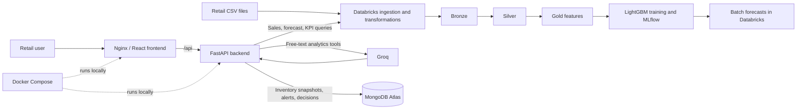

# RetailPulse AI

RetailPulse AI is a retail demand-forecasting and inventory-risk decision-support application. It combines a Databricks-based forecasting pipeline with a React dashboard, a FastAPI backend, Groq-powered analytics chat, and a MongoDB-backed inventory workflow.

The project is intended to demonstrate an end-to-end AI application for FDE and AI/ML portfolios, a practical MongoDB feature for NoSQL coursework, and a foundation for DevOps and DevSecOps practices.

## Problem statement

Retailers need to decide what products to replenish, at which locations, and when. Sales history can help estimate future demand, but a forecast alone does not say whether the store has enough inventory to meet that demand while waiting for a supplier delivery. Inventory observations, inbound shipments, lead times, and safety-stock targets are operational information that may not be present in analytical sales data.

RetailPulse AI brings these signals together. It forecasts demand by product and store, lets a user compare a submitted inventory snapshot with forecast demand during supplier lead time, highlights potential low-stock risk, and records the user's review decision. The application supports a human decision; it does not place purchase orders automatically.

## What the application does

- Ingests retail sales, product, store, and calendar/marketing CSV data into a Databricks medallion pipeline.
- Cleans and integrates records into Silver tables and creates daily product/store features in Gold.
- Trains and evaluates a global LightGBM regression model for daily units sold, tracks runs and model versions with MLflow, and produces batch forecasts.
- Presents historical sales, forecast charts, KPIs, forecast explanations, and analytics chat in a React web application.
- Calculates inventory risk from user-entered on-hand and inbound quantities, supplier lead time, safety stock, and matching forecast demand.
- Stores inventory snapshots, risk alerts, and manager-reviewed actions in MongoDB Atlas.
- Packages the frontend and backend into separate Docker images and runs them together locally with Docker Compose.

## Architecture



### Technology responsibilities

| Component | Responsibility |
|---|---|
| Databricks and Delta tables | Ingest, transform, explore, and serve the analytical retail data and forecasts. |
| LightGBM | Predict daily units sold for product/store combinations using historical, calendar, product, store, and other engineered features. |
| MLflow and Unity Catalog Model Registry | Track training runs, metrics, model versions, and the Champion/Challenger selection. |
| FastAPI | Provide REST APIs, validate requests, retrieve Databricks results, run inventory-risk calculations, and access MongoDB. |
| React and TypeScript | Render the dashboard, analytics chat, and inventory workflow. |
| Groq | Interpret free-text analytics questions and narrate results returned by approved backend analytics tools. Groq does not query Databricks directly or calculate authoritative forecasts or inventory risk. |
| MongoDB Atlas | Persist operational inventory snapshots, risk alerts, and reviewed replenishment actions. |
| Docker and Docker Compose | Build and run separate frontend and backend containers for local development and deployment preparation. |
| Nginx | Serve the built React application and proxy `/api` requests to FastAPI. |

AWS EC2 deployment, Terraform infrastructure, Jenkins CI/CD, Trivy security scanning, and Prometheus/Grafana monitoring are planned DevOps stages; they are not required to run the local Compose setup described below.

## Inventory risk workflow

The manager selects a product and store, then enters:

- **On-hand quantity:** usable stock currently available.
- **Inbound quantity and expected date:** stock already on the way and when it is expected to arrive.
- **Supplier lead time:** how many days a new delivery is expected to take.
- **Safety-stock threshold:** the reserve the manager wants to maintain.

For the selected product/store, the backend retrieves daily forecast rows from Databricks for the lead-time window. It requires a forecast for every day in that window. The calculation in `backend/src/inventory/risk.py` is:

```text
projected stock =
    on-hand quantity
    + inbound quantity arriving by the end of lead time
    - forecast demand during lead time
```

Projected stock at or below zero is classified as potential stockout; positive stock below the safety threshold is below safety stock; stock at or above the threshold is healthy. Incomplete forecast coverage is reported rather than silently estimated. A recent inventory snapshot does not necessarily mean its forecast data is recent, so check the forecast dates when interpreting a result.

MongoDB stores operational records, not the sales analytics or forecasting model. The frontend never connects directly to MongoDB.

## Analytics chat data flow

For free-text questions, React sends a request to FastAPI's `/chat` endpoint. The backend gives Groq a defined set of analytics tools. Groq may select a tool, but the backend executes it; `backend/src/data/analytics.py` calls parameterized SQL query helpers in `backend/src/data/db.py`, which access Databricks. The tool results are returned to Groq to produce a plain-language response. The backend returns the answer and data to the frontend.

Predefined quick questions use `/chat/quick` and deterministic formatters over the same analytics functions; they do not call the LLM. See [the project Q&A guide](Docs/RetailPulse_AI_Project_QA_Guide.md) for a file-by-file explanation.

## Data

The repository includes local CSV files under:

- `data/Initial-Training-Data/` — sales transactions, products, stores, and calendar/marketing data.
- `data/Jan-March-2026/` — additional sales and calendar/marketing files for those months.

The pipeline ingests CSV files into Databricks Unity Catalog Volumes and creates Bronze, Silver, and Gold tables. The repository does not establish the original publisher or license of these files; verify their provenance before redistribution or use beyond this project.

Inventory inputs are separate from these CSVs. They are entered in the application and saved to MongoDB.

## Run locally with Docker Compose

### Prerequisites

- Docker Desktop with Docker Compose.
- A configured Databricks workspace, SQL warehouse, and credentials.
- A MongoDB Atlas URI/database if you want to use inventory persistence.
- Groq credentials/model configuration if you want to use the LLM-backed chat and forecast explanations.

Create `backend/.env` with the configuration required by your backend integrations. At minimum, the relevant settings include:

- Databricks: `DATABRICKS_SERVER_HOSTNAME`, `DATABRICKS_HTTP_PATH`, `DATABRICKS_TOKEN`.
- MongoDB: `MONGODB_URI`, `MONGODB_DATABASE`.
- Groq: `GROQ_API_KEY`, `GROQ_MODEL`.

Add any other variables required by the pipeline or local configuration you use. Keep the real `.env` file private; never commit secrets or place them in frontend build arguments.

### Build and start

Run these commands from the repository root in PowerShell:

```powershell
Test-Path .\backend\.env
docker compose config --quiet
docker compose build
docker compose up -d
docker compose ps
```

`Test-Path` should return `True`. Compose builds the backend and frontend images; the backend receives runtime settings from `backend/.env`. The frontend is served by Nginx, which proxies `/api` requests to FastAPI.

Open:

- Frontend: <http://localhost:5173>
- FastAPI Swagger documentation: <http://localhost:8081/docs>
- Backend health endpoint: <http://localhost:8081/health>

The backend port is bound to `127.0.0.1:8081` for local use. The frontend is available on port `5173`.

### Logs and shutdown

```powershell
docker compose logs -f backend frontend
docker compose down
```

If Databricks calls fail, confirm that the configured SQL warehouse is running and that the hostname, HTTP path, and token are valid. If inventory requests fail, check Atlas cluster/network access and MongoDB configuration. The backend can start even when an external service is unavailable; its dependent endpoints may then return an error.

## Testing and quality checks

Backend inventory tests use Python `unittest` and FastAPI `TestClient`. From `backend`:

```powershell
.\.venv\Scripts\python.exe -m unittest discover -s tests -v
```

Frontend checks, from `frontend`:

```powershell
npm run build
npm run lint
```

There is currently no dedicated frontend unit/component test runner configured. Build, lint, and Docker/API smoke checks have been used for frontend validation.

## Repository map

```text
backend/
  main.py                    FastAPI application and API routes
  src/data/                  Databricks and MongoDB clients, SQL, analytics
  src/genai/                  Shared analytics-chat logic and Groq integration
  src/inventory/             Inventory risk rules, service, repository, routes
  src/models/                API request/response models
  tests/                     Inventory risk, service, and API tests
frontend/
  src/                       React application, pages, components, and API clients
  Dockerfile                 Multi-stage Vite build and Nginx runtime
  nginx.conf                 SPA routing and backend API proxy
Databricks/RetailPulse_AI/
  src/                       Databricks ingestion, transformations, training, inference
  resources/                 Databricks job configuration
data/                        Local source CSV files
Docs/                        Architecture, implementation, and presentation guides
compose.yaml                 Local frontend/backend orchestration
```

## Project documentation

- [Project brief and architecture](Docs/RetailPulse_AI_Project_Details.md)
- [MongoDB inventory feature guide](Docs/MongoDB_Inventory_Feature_Guide.md)
- [Project Q&A guide](Docs/RetailPulse_AI_Project_QA_Guide.md)
- [Backend data folder guide](Docs/Backend_Data_Folder_Guide.md)

## Scope and limitations

- Forecasts are estimates and are not guarantees.
- Inventory results depend on correct, fresh user-entered stock data and complete matching forecast dates.
- Risk outcomes support human review; no purchase order is created automatically.
- Groq produces language around data returned by backend tools; it is not the source of truth for metrics or calculations.
- Local Docker Compose is a development/demo setup, not a highly available production architecture.
